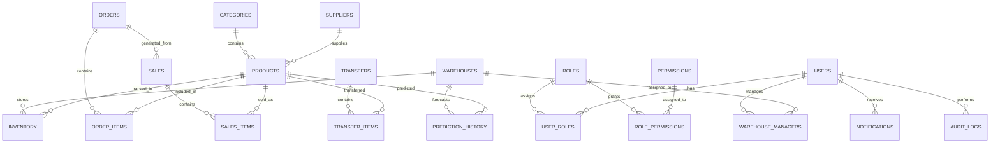

# ER Diagram

## Entity Summary
- Users, Roles, and Permissions form the access control model.
- Warehouses, Inventory, Orders, Sales, and Transfers form the warehouse operations model.
- Products, Categories, and Suppliers form the catalog and procurement model.
- Prediction History, Notifications, Audit Logs, and Settings support analytics and governance.
